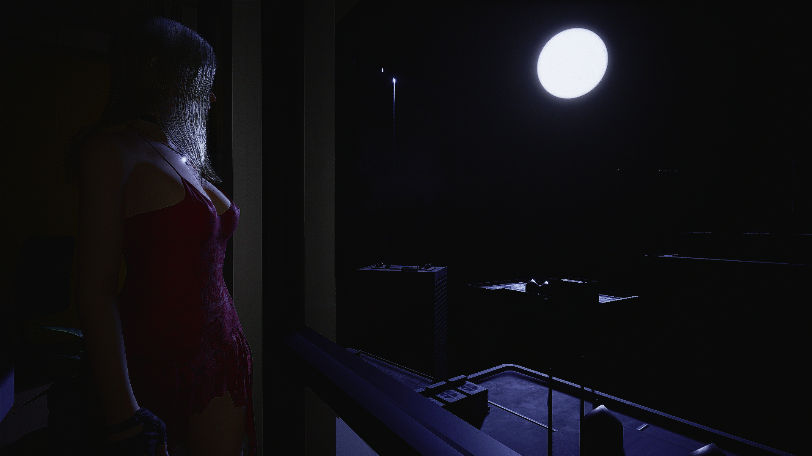
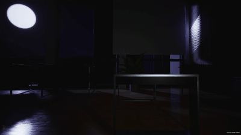
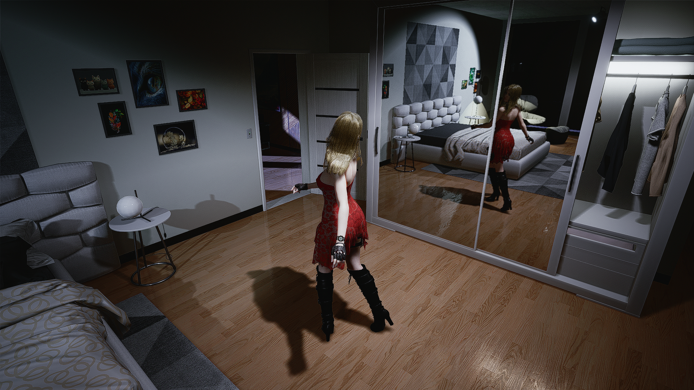
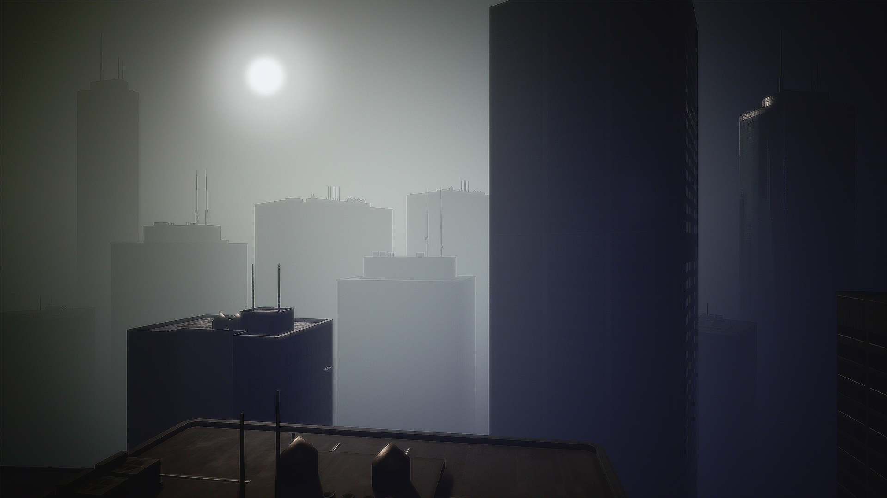
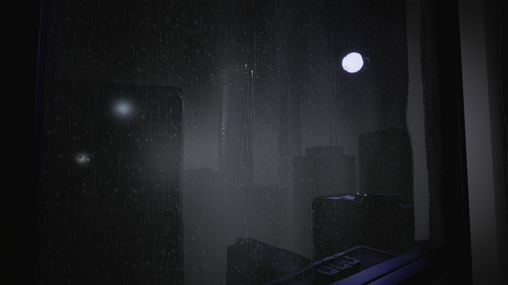
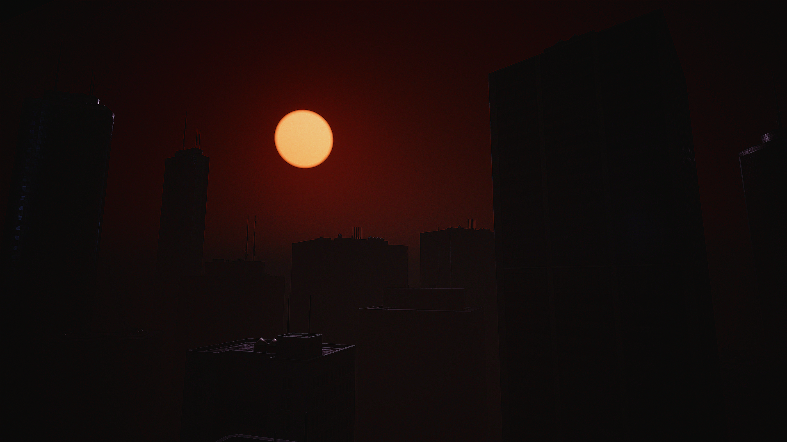

# Jodi's Sky

**Day, night, rain, storms and a city that is still out there, for Jodi's Office in *The Killing Antidote*, all set from AltUI.**

A dark city under the moon, the haze thickening between the towers, the room lit only by her lamps or her screens. Or a grey afternoon, rain streaming down the windows, lightning over the towers and thunder rolling in a few seconds later. And down in the streets, muffled by the glass: a groan, a scream cut short, a burst of gunfire, glass breaking, crows taking off. One toggle switches it, a page of settings tunes it, and it comes back by itself every time you load the office.

---

## Features

### Day and night

- **Night in one click**: AltUI's Mods tab, or the quick wheel (*Jodi's Sky › Night*). Day puts the office back exactly as the game made it.
- **A real night, not a filter**: the office's own lights are changed live. The sun becomes a moon, the sky and the city haze go dark blue, and the room really gets dark.
- **The moon**: its light on the room and on Jodi, the disc in the sky, its size (Real / Large / Huge / Giant) and its glow, each on its own slider.
- **Your lamps**: from full light to 0 %, where only the moon and the screens light the room. Made for movie nights with [DesktopTV](https://github.com/BenenG47/DesktopTV-v1).

  

- **Wardrobe-friendly**: night doesn't mean dressing in the dark. Keep the lamps bright enough and the wardrobe stays comfortable to use, while the city outside stays at night.

  

- **Sky colour**: from a cold blue night to a red dusk.
- **Fog, day and night**: thicker haze over the city, and how far from the window it starts. Jodi's room itself never gets foggy.

  

- **Follow the clock**: day and night switch by themselves with your PC's time, the time Jodi's clock shows, at the hours you choose. The Night toggle still works as a manual override until the next switch hour.

### Rain and storms

- **Rain**, by day and by night, also in the quick wheel (*Jodi's Sky › Rain*):
  - rain falling outside every window, in three layers (near, mid, far) so it has depth;
  - a grey, overcast sky: darker and foggier the heavier the rain;
  - a soft rain sound, muffled as if heard through the glass.
- **Water on the windows**: beads form, swell and dry on every pane; now and then one runs down and leaves a trail; in heavy rain a wavy water film streams down the glass, and the city behind it bends and blurs.

  

- **Storms**: lightning by day and by night, a bolt in the sky where you can see it from the office and the bedroom, a flash on the room and on Jodi, and thunder that arrives a few seconds later: a crack and a rolling rumble when it's close, a long low rumble when it's far. **New in 3.5**: the thunder comes from the side the lightning struck, and every strike has its own pitch, so no two sound the same.
- **Real glass in the gym**: the gym's three low windows get the same glass as the other windows, so they darken at night and show the rain and the drops.

### The streets (new in 3.5)

The city below the office is no longer silent. Every sound is far below, muffled by the glass, coming from the side of the street it happens in.

- **Calm ↔ Chaos**: one slider from long, uneasy silences broken by a distant moan, to a city still fighting all around you.
- **Zombies**: groans, snarls and choruses, a chase howl, the weeping and shrieking **Weeper**, the roar of a **Devourer** answered by the others. At night the **Nurse's laughter** and a **Predator's** shriek join in. Now and then, someone **runs past** in the street, something howling behind them.
- **Screams**: people crying for help, screams cut short, a man's last cry.
- **Gunfire**: single shots, bursts from pistols, SMGs and shotguns, and in chaos the odd explosion.
- **Loudspeaker**: the city's emergency broadcast, echoing between the towers. Rare.
- **City**: glass shattering, wood and furniture breaking, a wall or a door giving way, metal rattling in the distance. By day, **crows**, and a flock taking off after an explosion.
- **Little scenes**: sounds answer each other. A scream followed by gunfire, breaking glass followed by a scream, glass raining down after an explosion, crows startled by a burst…
- **Day and night feel different**: more zombies at night, more gunfire and people by day; rain makes the street rarer and a little quieter.
- **Jodi reacts**: when something happens close to her (a scream right below, a burst, a crash, a close thunder crack) she gasps, a hard gasp when it's very close, and catches her breath; after an announcement she sighs. At most once every few minutes, so it stays a surprise. Off by default.
- **Each group has its own switch**, and Street sounds as a whole is in the quick wheel (*Jodi's Sky › Street sounds*).

### Everything else

- **Remembered**: every setting is saved and applied by itself about a second after Jodi's Office loads.
- **Your own moods**: with AltUI 2.9, save any combination of settings as a preset tile with "+" at the top of the page (a stormy night, a quiet movie night…) and switch between them in one click.
- **Light**: a plain pak. No UE4SS, no game files replaced, nothing running outside Jodi's Office. Works on Linux (Steam / Proton) too.

---

## Requirements

1. **[Blueprint Loader](https://www.nexusmods.com/thekillingantidote/mods/994)**: starts the mod in the game.
2. **[AltUI](https://www.nexusmods.com/thekillingantidote/mods/988)**: the settings page and the quick-wheel toggles (2.9 or newer for the preset tiles).
   Without AltUI the mod still applies your last saved settings; you just can't change them.

No UE4SS needed.

**Optional**: the *VoiceTranslation* mod turns the loudspeaker's Chinese announcements into English.

---

## Installation

Copy `JodisSky.pak` into the game's `TheKillingAntidote\Mods\` folder (the game must be closed).

**Updating from Jodi's Sky 3.x?** Just replace `JodisSky.pak`; your settings are kept. Street sounds and Jodi reacts start off, so nothing changes until you turn them on (coming from 3.0, the rain settings start at their defaults, Rain off).

**Updating from OfficeNight?** Jodi's Sky is OfficeNight renamed. Delete `OfficeNight.pak` from `Mods\` (and turn off the old UE4SS *OfficeNight* script if you had it), or they will fight over the same lights. Settings start fresh under the new name.

**Uninstall**: delete `JodisSky.pak`. Its settings live in `%LOCALAPPDATA%\TheKillingAntidote\Saved\SaveGames\JodisSky.sav` and can be deleted too.

---

## Settings

AltUI › **Mods** › **Jodi's Sky**. Every change applies at once (sliders while you drag). The page is split in four sections.

| Setting | Range (default) | What it does |
|---|---|---|
| **Now** | | Day or Night, or "Not in Jodi's Office" |
| ***Clock*** | | |
| **Follow the clock** | on / off (off) | day and night switch by themselves with your PC's time (the time on Jodi's clock). See below |
| **Night from** | 0–23 (20) | the hour night begins |
| **Day from** | 0–23 (7) | the hour day begins |
| ***Night & sky*** | | |
| **Night** | on / off | switches day and night (also in the quick wheel) |
| **Room lamps (%)** | 0–100 (100) | the office's lamps at night. 20 = a dim room, 0 = only the moon and the screens |
| **Night sky (%)** | 0–300 (100) | brightness of the night sky, the sky light and the city haze |
| **Sky tint** | −100 blue … +100 dusk (0) | colour of the sky and the haze; the moonlight takes a little of it |
| **Moonlight** | 0–1.6 (0.8) | how strongly the moon lights the room and Jodi through the windows |
| **Moon size** | Real / Large / Huge / Giant | the size of the disc. Bigger looks dimmer: raise Moon disc a little |
| **Moon disc (%)** | 0–100 (100) | how bright the moon looks in the sky; 0 = no moon. The sky keeps its brightness |
| **Moon glow (%)** | 0–100 (100) | the halo around the moon; 0 = a crisp disc |
| **Fog (%)** | 100–500 (100) | **day and night**: how thick the haze is (only thicker than the game's, so the city never shows its edges) |
| **Fog start (m)** | 10–200 (10) | **day and night**: how far from the camera the haze begins. Around 30 m the nearby buildings clear while the far city stays hazy |
| ***Rain & storm*** | | |
| **Rain** | on / off (off) | rain, overcast sky and rain sound, day and night (also in the quick wheel) |
| **Rain strength (%)** | 0–100 (60) | how much rain falls, and how grey, dark and foggy the sky gets |
| **Rain sound (%)** | 0–100 (70) | the rain's volume; 0 = silent |
| **Window drops** | on / off (on) | beads and trickles on the windows (with Rain on) |
| **Water film** | on / off (on) | the water film streaming down the glass, from Rain strength 75 % |
| **Lightning** | on / off (on) | lightning, the flash and thunder (with Rain on); more often in heavier rain |
| **Thunder (%)** | 0–200 (70) | thunder volume; 0 = silent flashes. Above 100 % it gets louder than the sound itself, near 200 % the closest cracks may sound a little rough |
| ***Street*** | | |
| **Street sounds** | on / off (off) | the sounds of the city below (also in the quick wheel) |
| **Calm ↔ Chaos** | 0–100 (30) | how often things happen, and how big: rare and distant at 0, a city at war at 100 |
| **Street volume (%)** | 0–300 (100) | all the street sounds, under the game's sound-effects volume |
| **Zombies** | on / off (on) | groans, choruses, chase howls, the Weeper, the Devourer, someone running past; at night the Nurse and the Predator |
| **Screams** | on / off (on) | people screaming and crying for help |
| **Gunfire** | on / off (on) | shots, bursts and explosions |
| **Loudspeaker** | on / off (on) | the city's emergency broadcast (rare) |
| **City** | on / off (on) | glass, crashes, metal; crows by day |
| **Jodi reacts** | on / off (off) | her gasps and breath when something happens close to her, a sigh after an announcement; also with close thunder when Street sounds is off |
| **Reset the sliders** | | every slider back to its default; no on / off switch changes |
| **Back to the defaults** | | every slider and every switch back to a fresh install |

Neither button touches the clock (Follow the clock, Night from, Day from): that's yours.

The moon, lamp and sky settings act at night only; fog, rain and the street work day and night. At their defaults, with Rain and Street sounds off, Day is the game's own office (the haze just starts 10 m away, so the room is never foggy).

**Follow the clock**: when you turn it on, and every time Jodi's Office loads, it's night between *Night from* and *Day from* (for example 20 → 7: night from 8 pm to 7 am) and day the rest of the time. While you play it checks the time once a minute and switches when one of the two hours comes. You can still flip Night by hand (or with the quick wheel, or a preset tile); your choice holds until the next switch hour. With both hours the same it never switches.

**The street**: nothing plays during the first 20 seconds in the office. A group you switch on starts within a few seconds; one you switch off goes quiet at once. Rain makes the street a little rarer and quieter; raise Street volume if heavy rain covers it too much.

---

## Good to know

- It only does something in **Jodi's Office**. Everywhere else it stays idle.
- The moon is the office's own sun, turned down and tinted. It sits where the game puts the sun.
- The glow around a bright moon partly comes from the game's bloom effect.
- Another mod that changes the office's lights at the same time will fight with it; use one at a time.
- Rain, drops, lightning and the street cost next to nothing: nothing runs between two sounds, and with Rain and Street sounds off nothing extra happens at all.
- The rain and thunder sounds are made by the mod's own scripts (no recordings). The street plays **the game's own sounds**, straight from your game, so a mod that replaces one of them (a louder gun, a different zombie) is heard in the street too.

---

## Credits

- **BenenG47**: the mod.
- **Zyiakk**: [AltUI](https://github.com/Zyiakk/AltUI), whose Mods tab and quick wheel give Jodi's Sky its page, and the name.
- **The Blueprint Loader's author**: [Blueprint Loader](https://www.nexusmods.com/thekillingantidote/mods/994).

