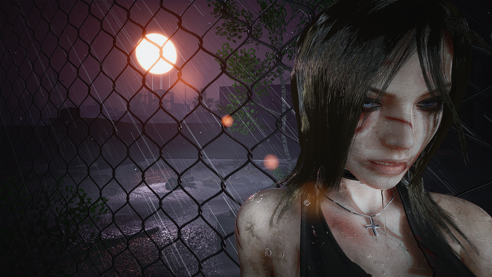
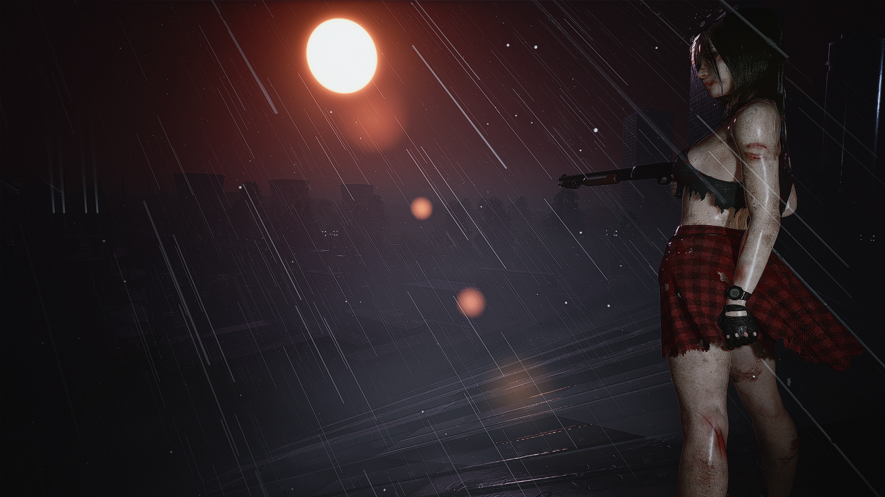

# Jodi's Sky - Weather Overhaul 4.0

**Day, night, weather and a city that is still out there, for Jodi's Office and the Abandoned Hangar in *The Killing Antidote*. Rain that falls, blows and soaks her. All set from AltUI.**

A grey storm rolling over the towers, rain slanting past the windows in the gusts, thunder a few seconds after the flash. Jodi caught outside in it: rain beading on her skin, dripping from her chin and fingertips, her hair darkening as it soaks. Back inside, she's still shivering, and the sneezes come. Or a quiet night under a red moon, the room lit only by her lamps, the street muffled far below.

---

## What's new in 4.0

- **A second map: the Abandoned Hangar.** The whole sky (day, night, moon, fog, storms) now works there too, with a real 3D rain you can walk through: drops at every distance, splashes, ripples and puddles on the ground, drops on the screen when the camera is out in it.
- **The same rain in Jodi's Office.** The windows now show the same 3D rain as the hangar, leaning with the wind from every window, with drumming on the roof above her.
- **Weather that changes by itself.** Random weather moves between clear, light, medium and heavy rain, mist and thick fog, calm and gales. One weather for the whole game: it follows Jodi from one map to the other.
- **Sky moods.** Now and then a night under a **Blood moon** or a **Freezing blue** sky, or a **Cold grey day**.
- **Water on Jodi.** Out in the rain her skin gets wet and glossy: rings where drops hit, beads that form and run, streams down her body, water on her clothes and hair, drops that hang and fall from her chin, nose, fingers, knees and hair tips. Her hair darkens as it soaks. She stays wet when she goes inside, and dries slowly.
- **She can catch a cold.** Soaked for too long (worse at night, in the wind, in heavy rain), she starts to cough, then to sneeze. She tries to hold a sneeze in when she's aiming or when someone is close by, and zombies can hear her.
- **A new "Jodi" tab:** her reactions, sneezing, and the **flashlight while aiming** (with the Glock or the Revolver, the flashlight key now switches the light while she aims).
- **Clearer settings:** the page is split into tabs and folding sections, with clearer names.

---

## Requirements

1. **[Blueprint Loader](https://www.nexusmods.com/thekillingantidote/mods/994)**: starts the mod in the game.
2. **[AltUI](https://www.nexusmods.com/thekillingantidote/mods/988) 2.11 or newer**: the settings page (tabs and sections) and the quick-wheel toggles.
   Without AltUI the mod still applies your last saved settings; you just can't change them.

No UE4SS needed. **Optional:** the *VoiceTranslation* mod turns the loudspeaker's Chinese announcements into English.

---

## Installation

Copy `JodisSky.pak` into the game's `TheKillingAntidote\Mods\` folder (the game must be closed).

**Updating from 3.x?** Replace `JodisSky.pak`; your settings are kept. Everything new starts at its default; "Reset this tab (sliders and switches)" sets that tab to the 4.0 defaults.

**Uninstall:** delete `JodisSky.pak`. Its settings live in `%LOCALAPPDATA%\TheKillingAntidote\Saved\SaveGames\JodisSky.sav` and can be deleted too.

---

## The settings page

Open AltUI's **Mods** tab, then **Jodi's Sky**. Every tab ends with three buttons: **Reset this tab's sliders**, **Reset this tab (sliders and switches)**, and on the first tab **Reset ALL tabs**. With AltUI's "+" at the top of the page you can save any combination as your own preset tile. The mod also comes with three: *Crimson Deluge*, *Pale Moon Plague* and *Silent Chill*.

### Sky & weather

- **Clock:** *Follow the clock* switches day and night with your PC's time, at the hours you choose.
- **Weather:** *Random weather* on, and the weather takes care of itself. *Heaviest random rain* and *Thickest random fog* cap it; *How long the weather lasts* slows or speeds the changes; *Sky moods* and their chance; *Wind strength* tones the wind down or up everywhere.
- **Night & sky:** *Night*, *Night brightness*, *Sky colour* (cold blue ↔ red dusk), *Moonlight*, the moon's size, brightness and halo.
- **Fog** and **Rain & storm:** *Rain*, *Rain strength* (without random weather), *Rain sound*, *Lightning*, *Thunder volume*. *Storm grows with the rain*: thunder only once the rain is heavy enough, and close only in the heaviest rain.

### Jodi's Office

- **Room & windows:** your lamps (down to 0 %, the moon and the screens only), where the city haze starts, *Raindrop visibility, office* (the office's own: the drops through the windows are seen from far, so they need more), the drops and the water film on the panes.
- **Street:** the city below, muffled by the glass, from the side of the street it happens in. *Calm ↔ Chaos* from long uneasy silences to a city still fighting all around you. *City* (glass, crashes, doors in the building; crows by day), *Zombies* (the Weeper, a Devourer's roar, the Nurse's laughter at night, someone running past…), *Screams*, *Gunfire*, the *Loudspeaker*. Sounds answer each other, and day and night feel different. On by default.
- **Surprises:** *Occasional surprises* and *Uninvited*. What they do is in the spoiler section at the end.

### Rain outside

The 3D rain's look and sound.

- **In both maps:** *Drops* (amount, size, streaks; *Raindrop visibility* is the hangar's - the office has its own), *Veil & air* (the far rain veil, mist, haze around lights), *Sound* (rain heard indoors, drumming on roofs).
- **Only where Jodi can walk outside (the hangar):** *Splashes* and ripples, *Ground spray*, *Puddles*, wet footsteps, *Screen drops*.

### Jodi

- **Jodi reacts:** she gasps when something happens close to her (a scream right below, a burst, a crash, a close thunder crack) and catches her breath; after an announcement she sighs.
- **Sneezing:** soaked for a few minutes (*Catches a cold after*), she gets cold: first a cough, then sneezes now and then until she warms up again. *Sneeze now* lets you hear and pick your favourite sneeze, its look and its sound in *Sneeze look & sound*. *Zombies hear her sneeze* (and how far).
- **Flashlight:** *Flashlight while aiming* - with the Glock or the Revolver she holds the flashlight under the gun; the flashlight key switches it on and off while she aims.

### Water on Jodi

*Wet skin* on, and the rain shows on her: *Getting wet* and *Drying time*, rings, beads, streams, clothes and hair water, **wet hair** (darker, glossier), **splashes on Jodi**, and **drips** from her body (pick the spots: chin, nose, nipples, elbows, knees, fingers…). *Keep wetness between maps*: she arrives in the office as wet as she left the hangar.

### Water: fine-tuning and Hair drips

Everything about the hanging and falling drops, beads and streams, and the drips from her hair tips, for those who want to tune them. Folded by default; the defaults are tuned already.

---

## Good to know

- It works in **Jodi's Office** and the **Abandoned Hangar**. Everywhere else it stays idle.
- **Light on your PC:** the rain costs about 1 ms on a mid-range PC, and nothing when it's off. A slider at 0 switches its part off completely.
- The street, the zombies and Jodi's gasps are **the game's own sounds**, straight from your game: a mod that replaces one of them is heard here too.
- Another mod that changes the office's or the hangar's lights at the same time will fight with it; use one at a time.
- The wardrobe mirror may show a few raindrops in the doorway toward the office, at some angles. It's the mirror's own short view distance; the rain itself is outside.

---

## Credits

- **BenenG47**: the mod.
- **Zyiakk**: [AltUI](https://github.com/Zyiakk/AltUI), whose Mods tab, tabs and quick wheel give Jodi's Sky its page.
- **The Blueprint Loader's author**: [Blueprint Loader](https://www.nexusmods.com/thekillingantidote/mods/994).
- **[Pixabay](https://pixabay.com)**: the thunder recordings and Jodi's three sneezes (Pixabay Content License).
- **[Claude](https://claude.ai)** (Anthropic's AI): for doing most of the work.

---

## Surprises (spoilers)

**⚠ Spoilers.** Read on only if you want to know what *Occasional surprises* and *Uninvited* do. It's more fun not to.

Show the spoilers

Very rarely, about once every 15–30 minutes in Jodi's Office, a door that has been left open for a while closes by itself behind Jodi's back. It's the game's own door, with its own swing and sound, and never while she's looking at it or standing next to it. Sometimes it slams too hard and bounces back open. Jodi may catch her breath softly.

Untick **Occasional surprises** to stop it.

**Uninvited**: about once for every hour Jodi spends in her office (the time adds up across visits), a window breaks somewhere in the flat, muffled through the walls like one more sound from the street, and glass falls under it. Something got in: a **Weeper** crying in the bathroom until she hears Jodi, a **Bloodworm** in the bathroom, or a **Crawler** in the gym. They're the game's own zombies and fight like anywhere else. It never happens in the first two minutes after the office loads, never where Jodi can see, and only one at a time. Untick **Uninvited** and it's gone at once. AltUI followers set to "Attackable" are fair game too.

